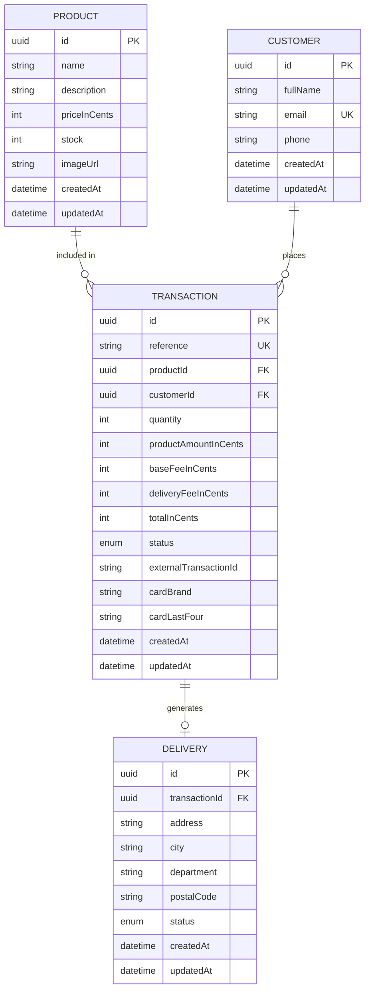

# quickpay-ecommerce
Prueba tecnica-DanielGuillermoPriolo 

# QuickPay E-Commerce Checkout

Aplicación Full-Stack de comercio electrónico y checkout con tarjeta de crédito construida con **Arquitectura Hexagonal**, **Railway Oriented Programming (ROP)**, persistencia resiliente en el cliente y estándares de seguridad **OWASP**.

---

## Enlaces en Producción

| Servicio | Plataforma | URL |
|---|---|---|
| **Frontend (SPA)** | Vercel | https://quickpayecommerce.vercel.app |
| **Backend API** | Render (Docker) | https://quickpay-ecommerce.onrender.com/api |
| **Documentación Swagger** | Render (OpenAPI) | https://quickpay-ecommerce.onrender.com/api/docs |
| **Base de Datos** | Neon (PostgreSQL) | PostgreSQL 16 con SSL (`sslmode=require`) |

> **Nota sobre el entorno gratuito:** El contenedor del backend en Render entra en reposo tras 15 minutos sin tráfico; la primera petición puede tardar ~30 segundos en responder.

---

## Stack Tecnológico

- **Backend:** NestJS, TypeScript, Prisma ORM, PostgreSQL, Helmet, Swagger, Jest (`ts-jest`).
- **Frontend:** React, TypeScript, Redux Toolkit, Vite, Tailwind CSS, Axios, Jest + React Testing Library.
- **Infraestructura:** Docker (multi-stage build), Neon, Render, Vercel.

---

## Arquitectura del Proyecto

### Backend — Arquitectura Hexagonal + ROP

El dominio y los casos de uso están desacoplados del framework HTTP, de Prisma y de la pasarela de pagos mediante **Puertos e Interfaces** y manejo funcional de errores (`Result<T, E>`):

```text
Backend/src/
├── domain/                  # Entidades puras (Product, Customer, Transaction, Delivery) y Puertos
├── aplication/use_cases/    # Casos de uso (GetProducts, CreateTransaction, ProcessPayment, GetTransaction)
├── shared/
│   ├── rop/                 # Implementación de Result<T, E> (ok / fail)
│   └── errors/              # Errores tipados de dominio
└── infra/
    ├── http/                # Controladores NestJS, DTOs validados y mapeador Result -> HTTP
    ├── persistence/         # Adaptadores de repositorios con Prisma ORM
    └── gateway/             # Adaptador de pasarela de pagos Sandbox (firma SHA-256)
```

### Frontend — Flujo de Checkout en 5 Pasos (Mobile-First)

1. **Catálogo de Productos:** Visualización en tiempo real de inventario y selector de cantidad.
2. **Modal de Pago y Envío:** Validación en cliente con algoritmo de **Luhn**, detección automática de franquicia (**VISA / MasterCard**), fecha de expiración y CVC.
3. **Resumen de Pago (Backdrop):** Desglose transparente de producto, tarifa base y envío.
4. **Procesamiento y Persistencia:** Creación de transacción `PENDING`, cobro en pasarela Sandbox y actualización atómica de inventario. El estado del flujo persiste en `localStorage` (excluyendo datos sensibles de tarjeta) para soportar recargas del navegador.
5. **Resultado de Transacción:** Comprobante detallado (`APPROVED` / `DECLINED`) y retorno al catálogo con stock actualizado.

---

## Modelo Entidad-Relación (PostgreSQL / Prisma)



---

## Endpoints Principales de la API

Documentación interactiva disponible en `/api/docs`.

| Método | Ruta | Descripción |
|---|---|---|
| `GET` | `/api/health` | Verificación de estado del servicio |
| `GET` | `/api/products` | Lista los productos disponibles con stock actualizado |
| `POST` | `/api/transactions` | Crea una transacción en estado `PENDING`, cliente y orden de envío |
| `POST` | `/api/transactions/:id/pay` | Procesa el pago en la pasarela Sandbox y descuenta stock si es `APPROVED` |
| `GET` | `/api/transactions/:id` | Consulta el detalle y estado de una transacción y su entrega |

---

## Cobertura de Pruebas Unitarias (Jest)

Ambas capas superan el umbral del 80% exigido:

| Capa | Suites | Statements | Branches | Functions | Lines |
|---|---|---|---|---|---|
| **Backend** (`Jest` + `ts-jest`) | 6 / 6 PASS | **92.48%** | 51.40% | **97.58%** | **92.32%** |
| **Frontend** (`Jest` + `RTL`) | 5 / 5 PASS | **93.92%** | **85.96%** | **91.42%** | **94.42%** |

Comandos de ejecución:

```bash
# Backend
cd Backend && npm run test:cov

# Frontend
cd Frontend && npm run test:cov
```

---

## Seguridad (OWASP)

- **Cabeceras HTTP seguras:** Configuradas con `Helmet` en el Backend (`HSTS`, `X-Frame-Options: DENY`, `X-Content-Type-Options: nosniff`, `Referrer-Policy`) y mediante `Frontend/vercel.json` en Vercel (incluyendo `Content-Security-Policy` y `Permissions-Policy`).
- **Validación estricta de entrada:** `ValidationPipe` global con `whitelist: true` y `forbidNonWhitelisted: true`, además de límite de payload de `50kb`.
- **Protección de datos de tarjeta:** Nunca se persiste el número completo de tarjeta (PAN) ni el CVC en base de datos ni en `localStorage`; únicamente se almacenan franquicia y últimos 4 dígitos.
- **CORS restringido:** Lista blanca de orígenes autorizados mediante variables de entorno.

---

## Ejecución Local

### 1. Backend

```bash
cd Backend
npm install
cp .env.example .env   # Configura DATABASE_URL y llaves Sandbox
npx prisma migrate deploy
npx prisma db seed
npm run start:dev
```

### 2. Frontend

```bash
cd Frontend
npm install
cp .env.example .env   # Configura VITE_API_URL=http://localhost:3000/api
npm run dev
```

---

## Flujo de Ramas (GitFlow)

Desarrollo organizado mediante ramas por hito (`feat/*`, `test/*`) integradas en `develop` y liberadas en `main`.

Backend 
-----------------------------------|---------|----------|---------|---------|-----------------------------
File                               | % Stmts | % Branch | % Funcs | % Lines | Uncovered Line #s           
-----------------------------------|---------|----------|---------|---------|-----------------------------
All files                          |   92.48 |     51.4 |   97.58 |   92.32 |                             
 aplication/use_cases              |   91.54 |    56.81 |   92.85 |    90.9 |                             
  create-transaction.use-case.ts   |   94.23 |    56.25 |     100 |   93.87 | 116,135,181                 
  get-products.use-case.ts         |   94.44 |       50 |     100 |   93.75 | 38                          
  get-transaction.use-case.ts      |   94.11 |       50 |     100 |   93.33 | 45                          
  process-payment.use-case.ts      |   87.27 |    61.11 |   81.81 |   86.53 | 105,109,118,127,156,160,210 
 domain/entities                   |     100 |      100 |     100 |     100 |                             
  customer.entity.ts               |     100 |      100 |     100 |     100 |                             
  delivery.entity.ts               |     100 |      100 |     100 |     100 |                             
  product.entity.ts                |     100 |      100 |     100 |     100 |                             
  transaction.entity.ts            |     100 |      100 |     100 |     100 |                             
 infra/gateway                     |   76.92 |    37.77 |    90.9 |   77.77 |                             
  sandbox-payment.gateway.ts       |   76.92 |    37.77 |    90.9 |   77.77 | 120,147,223-233,241-255,269 
 infra/http/controllers            |     100 |       50 |     100 |     100 |                             
  health.controller.ts             |     100 |      100 |     100 |     100 |                             
  products.controller.ts           |     100 |      100 |     100 |     100 |                             
  transactions.controller.ts       |     100 |       50 |     100 |     100 | 93                          
 infra/http/helpers                |     100 |       75 |     100 |     100 |                             
  result-to-http.helper.ts         |     100 |       75 |     100 |     100 | 12                          
 infra/persistence                 |     100 |       70 |     100 |     100 |                             
  prisma-customer.repository.ts    |     100 |      100 |     100 |     100 |                             
  prisma-delivery.repository.ts    |     100 |       50 |     100 |     100 | 33                          
  prisma-product.repository.ts     |     100 |      100 |     100 |     100 |                             
  prisma-transaction.repository.ts |     100 |       50 |     100 |     100 | 37-44                       
 shared/errors                     |     100 |      100 |     100 |     100 |                             
  domain.error.ts                  |     100 |      100 |     100 |     100 |                             
 shared/rop                        |     100 |      100 |     100 |     100 |                             
  result.ts                        |     100 |      100 |     100 |     100 |                             
-----------------------------------|---------|----------|---------|---------|-----------------------------
Frontend 
------------------------|---------|----------|---------|---------|-------------------
File                    | % Stmts | % Branch | % Funcs | % Lines | Uncovered Line #s 
------------------------|---------|----------|---------|---------|-------------------
All files               |   93.92 |    85.96 |   91.42 |   94.42 |                   
 src                    |   93.02 |    88.23 |   81.81 |      95 |                   
  App.tsx               |   93.02 |    88.23 |   81.81 |      95 | 163-175           
 src/app                |   82.35 |       50 |     100 |   81.25 |                   
  store.ts              |   82.35 |       50 |     100 |   81.25 | 14-22             
 src/components         |     100 |      100 |     100 |     100 |                   
  CardBrandBadge.tsx    |     100 |      100 |     100 |     100 |                   
 src/feat/checkout      |   92.72 |    83.67 |   89.65 |   92.66 |                   
  PaymentModal.tsx      |   96.49 |    95.91 |   88.23 |   96.42 | 297,476           
  PaymentResultPage.tsx |     100 |    85.18 |     100 |     100 | 41,54,79,99       
  SummaryBackdrop.tsx   |     100 |    85.71 |     100 |     100 | 86,144            
  checkoutSlice.ts      |   85.36 |        0 |      90 |   85.36 | 91-99,161-162     
 src/feat/products      |   97.72 |    95.45 |   93.75 |   97.56 |                   
  ProductListPage.tsx   |   95.65 |      100 |   88.88 |   95.23 | 130               
  productsSlice.ts      |     100 |       75 |     100 |     100 | 54                
 src/services           |     100 |      100 |     100 |     100 |                   
  api.service.ts        |     100 |      100 |     100 |     100 |                   
 src/utils              |   95.74 |    84.61 |     100 |   97.72 |                   
  card-validation.ts    |   95.45 |    84.61 |     100 |   97.56 | 37                
  currency.ts           |     100 |      100 |     100 |     100 |                   
------------------------|---------|----------|---------|---------|-------------------